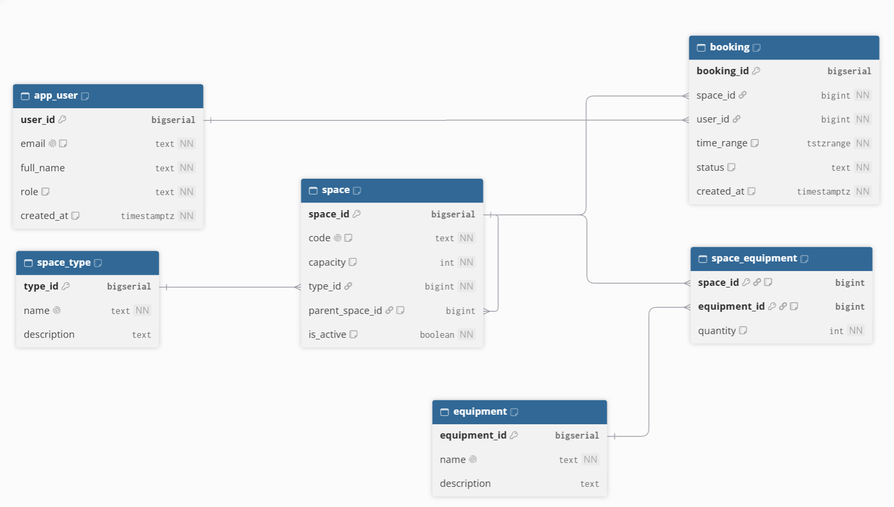

# Создание ER-диаграммы

Для создания ER-диаграммы использовался сервис dbdiagram.io

На рисунке ниже представлена ER-диаграмма


Ниже представлен код, по которому можно сгенерировать диаграмму.
```
Table app_user {
user_id bigserial [pk]
email text [not null, unique, note: 'Альтернативный ключ. CHECK: position(\'@\' in email) > 1']
full_name text [not null]
role text [not null, default: 'member', note: 'CHECK: guest, member, admin']
created_at timestamptz [not null, default: `now()`]

Note: 'Пользователи системы'
}

Table space_type {
type_id bigserial [pk]
name text [not null, unique]
description text

Note: 'Справочник типов пространств (опенспейс, переговорная)'
}

Table equipment {
equipment_id bigserial [pk]
name text [not null, unique]
description text

Note: 'Справочник оборудования (проектор, доска)'
}

Table space {
space_id bigserial [pk]
code text [not null, unique, note: 'Альтернативный ключ (например, A101)']
capacity int [not null, note: 'CHECK: capacity > 0']
type_id bigint [not null, ref: > space_type.type_id]
parent_space_id bigint [ref: > space.space_id, note: 'РЕКУРСИВНАЯ СВЯЗЬ: родительское пространство (этаж)']
is_active boolean [not null, default: true]

Note: 'Физические пространства (рабочие места, комнаты)'
}

// Слабая сущность (Промежуточная таблица для M:N)
Table space_equipment {
space_id bigint [ref: > space.space_id, note: 'FK, часть составного PK']
equipment_id bigint [ref: > equipment.equipment_id, note: 'FK, часть составного PK']
quantity int [not null, default: 1, note: 'CHECK: quantity > 0']

indexes {
(space_id, equipment_id) [pk] // Составной первичный ключ
}

Note: 'Слабая сущность. Связь M:N между пространствами и оборудованием'
}

Table booking {
booking_id bigserial [pk]
space_id bigint [not null, ref: > space.space_id]
user_id bigint [not null, ref: > app_user.user_id]
time_range tstzrange [not null, note: 'EXCLUSION CONSTRAINT на пересечение (&&) для статуса CONFIRMED']
status text [not null, default: 'CONFIRMED', note: 'CHECK: CONFIRMED, CANCELLED, EXPIRED']
created_at timestamptz [not null, default: `now()`]

Note: 'Факты бронирования'
}
```